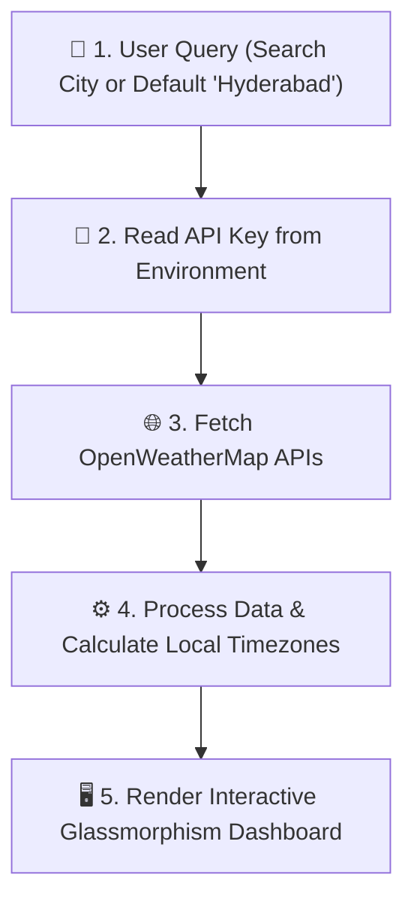

# CloudPulse ⛅

CloudPulse is a modern, responsive web application that provides real-time weather forecasts, air quality tracking, and atmospheric metrics for cities worldwide. Built with HTML5, CSS3 glassmorphism, and vanilla JavaScript, it connects directly to the OpenWeatherMap API suite while protecting credentials through an environment file (`.env`).

---

## Live Demo

- **Live Here:** [CloudPulse](https://cloudpulse-weather.netlify.app/)

---

## 🏗️ Architecture & How It Works

CloudPulse follows a clean, single-direction data flow:



### Step-by-Step Flow

1. **User Query / Startup**:
   - On initial load, the app automatically queries the default city (**Hyderabad**).
   - Users can search for any global city via the search bar.

2. **Environment & Security**:
   - The application reads the OpenWeather API key from the local `.env` file.
   - The `.env` file is excluded from version control via `.gitignore` to keep credentials secure.

3. **API Integration**:
   - **Current Weather API** (`/weather`): Fetches temperature, weather conditions, coordinates, and city timezone offset.
   - **Air Pollution API** (`/air_pollution`): Retrieves concentrations for PM2.5, PM10, NO2, O3, SO2 and calculates the AQI status.
   - **5-Day / 3-Hour Forecast API** (`/forecast`): Retrieves 5-day daily forecasts and upcoming 3-hour intervals.

4. **Data Transformation**:
   - Converts UTC timestamps into the **exact local time, date, sunrise, and sunset** of the searched city using the city's UTC timezone offset.
   - Formats values with scientific units: Humidity (`%`), Pressure (`hPa`), Temperatures (`°C`).
   - Maps numerical AQI (1–5) to color-coded qualitative ratings (*Good*, *Fair*, *Moderate*, *Poor*, *Very Poor*).

5. **Dashboard Rendering**:
   - **Current Weather Card**: Displays city name, temperature, weather icon, condition, local date, and local time.
   - **5-Day Forecast**: Shows upcoming daytime forecasts with icons and dates.
   - **Weather Metrics Grid**: 4 key atmospheric indicators (Humidity, Pressure, Feels Like, Min Temp).
   - **Air Quality & Sun Cycle**: Live pollutant levels, AQI rating badge, and sunrise/sunset times.
   - **Hourly Forecast**: Scrollable cards covering upcoming 3-hour forecast slots.

---

## 🔐 API Key Configuration

Your API key is kept separate in a `.env` file to ensure it is protected and never pushed to GitHub.

1. **Create your `.env` file**:
   Copy `.env.example` to `.env`:
   ```bash
   cp .env.example .env
   ```

2. **Add your API key**:
   Open `.env` and set your OpenWeatherMap API key:
   ```env
   OPENWEATHER_API_KEY=your_openweathermap_api_key_here
   ```

> The `.env` file is included in `.gitignore` so your API key will remain safe and private.

---

## 🛠️ Technologies Used

| Technology | Purpose |
| :--- | :--- |
| **HTML5** | Semantic layout and structure |
| **CSS3** | Glassmorphism design, Flexbox, CSS Grid, animations |
| **JavaScript (ES6+)** | Asynchronous fetch calls, DOM rendering, timezone math |
| **Bootstrap 5.3.3** | Responsive grid and utility classes |
| **OpenWeatherMap API** | Real-time weather, air pollution, and forecast data |

---

## 📁 Project Structure

```
CloudPulse/
│
├── index.html                             # Main HTML dashboard template
├── style.css                              # Glassmorphism styling and responsive rules
├── script.js                              # Application logic and OpenWeather API integration
├── env.js                                 # Local environment variables (protected by .gitignore)
├── env.example.js                         # Example environment template
├── .env                                   # Secret API key (protected by .gitignore)
├── .env.example                           # Template environment file
├── .gitignore                             # Git ignore rules (env.js, .env, OS, temp files)
├── README.md                              # Project documentation
│
├── calendar.png                           # Date indicator icon
├── time.png                               # Time indicator icon
├── search.png                             # Search button icon
├── weather.png                            # Application favicon and default icon
├── flood.png                              # Humidity metric icon
├── wind (1).png                           # Atmospheric pressure metric icon
├── hot.png                                # Feels-like temperature metric icon
├── image (1).png                          # Minimum temperature metric icon
├── wind.png                               # Air Quality Index icon
├── sun (1).png                            # Sunrise indicator icon
├── moon.png                               # Sunset indicator icon
├── cloud.png, clouds.png, cloudy.png      # Supplemental weather icons
└── sun-shining-dark-clouds-green-field.jpg# Dashboard background image
```

---

## 🚀 How to Run the Project

1. **Clone the repository**:
   ```bash
   git clone https://github.com/muralikrishna-27/CloudPulse.git
   cd CloudPulse
   ```

2. **Set up your `.env` file**:
   Ensure `.env` contains your OpenWeather API key:
   ```env
   OPENWEATHER_API_KEY=your_openweathermap_api_key_here
   ```

3. **Start a local server**:
   Because modern web browsers require a server context to read `.env` via `fetch`:
   - Using VS Code: Right-click `index.html` and choose **"Open with Live Server"**.
   - Or with Node.js: `npx serve .`
   - Or with Python: `python -m http.server 8000`

4. **Explore the dashboard**:
   Open `http://localhost:8000` (or your local server port) in your browser and search for any city.
